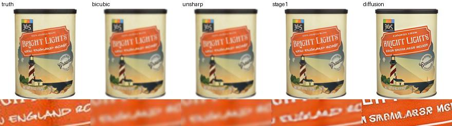

# Detail fidelity in diffusion restoration

Compare a conventional baseline, a trained SwinIR cleaner and DiffBIR v2.1 using known degradation and pixel-aligned references. The zoom below shows a failure on the blurred coffee tin. Full diffusion sharpens the package graphics but invents letters in the label.



After installing the GPU environment, `python run.py demo` processes one case through all four methods. For a quick CPU-only comparison run `python run.py demo --classical-only`.

## Setup and reproduction

Use Python 3.11. Install CUDA-enabled PyTorch 2.4.1 and torchvision 0.19.1 first, then `python -m pip install -r requirements-gpu.txt`. The code acquires the pinned official DiffBIR checkout and three SHA-256-verified weights. Set DIFFBIR_SOURCE to reuse a checkout that has its weights directory populated. The reported run used an RTX 4060 Laptop GPU (8 GiB), fp16, 10 diffusion steps and tiled VAE / denoising.

```sh
python -m unittest discover -s tests
python -m src.upstream_example
python run.py demo
python run.py reproduce
python run.py evaluate
```

The upstream example is the original repository's `inputs/demo/bsr/comic3.png`, restored at 2× to 512×512. Its input and both local output hashes are recorded. [Official-input reproduction](results/upstream/diffusion.json)

## Held-out results

Four catalog products (two development and two held out) were evaluated with separate blur, noise and JPEG degradations. The resulting 256×256 inputs were restored to 512×512. The table averages the six held-out cases. SwinIR is the actual intermediate tensor captured within the same DiffBIR forward pass that produced each final image.

| Method | PSNR (dB) ↑ | Excess edge energy ↓ | Label-crop MAE (unit RGB) ↓ |
|---|---:|---:|---:|
| Bicubic | 30.146 | 0.00564 | 0.03097 |
| Unsharp mask | 28.546 | 0.01237 | 0.03675 |
| SwinIR first stage | 30.428 | 0.00197 | 0.02983 |
| Full DiffBIR v2.1 | 23.697 | 0.03458 | 0.06033 |

Under these controlled degradations, full diffusion had higher pixel error and added edges absent from the reference. On the most affected held-out case, the blurred coffee tin, its PSNR was 20.308 dB. Across all twelve inputs the full two-stage GPU pipeline took 4.11 s/image on average and reached 4,783 MiB peak allocated CUDA memory (model loading excluded). The fixed central crop and edge score are pixel-level proxies; they do not measure spelling accuracy or human perceptual quality. The evaluation covers these four product packshots and this 10-step configuration. [Per-case scores](results/formal/scores.csv) · [Held-out summary](results/formal/summary.json) · [Failure selection](results/formal/highest-excess-edge.json)

## Code and supporting experiments

- `src/data.py` fetches and hashes the public input photographs. `run.py` fixes seeds, constructs the paired inputs and computes metrics from predictions already on disk.
- `src/restore.py` invokes the original BSRInferenceLoop, captures the first-stage image before diffusion, and measures GPU time and memory. `src/fetch_full.py` pins and verifies the external checkpoints.
- `python run.py reproduce --stage1-only` runs the actual SwinIR cleaner on CPU. Its 12 PNGs were reproduced byte-identically in a private clean clone. The CPU float32 and GPU fp16 outputs are tracked separately. [CPU verification](results/clean-clone-stage1.json)
- Use `--output SOME_DIRECTORY` to separate independent runs. The data license and sources are recorded in [data.md](data.md) and [UPSTREAM.md](UPSTREAM.md). Current state is in [HANDOFF.md](HANDOFF.md).

