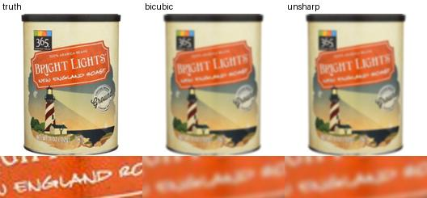

# Diffusion restoration fidelity

Measure which details survive restoration by comparing predictions with a known original. Product images with legible packaging provide consistent text regions and high-contrast edges.

For a quick CPU experiment install Pillow, NumPy, SciPy and requests and run `python run.py reproduce --classical-only`. This evaluates bicubic and unsharp reconstruction on generated noise, blur and JPEG degradations. Two product IDs form the development set and two form the held-out set. `python run.py evaluate --classical-only` regenerates the table from saved pixels.

For all four methods, use Python 3.11, install the upstream dependencies at the revision in UPSTREAM.md (including CUDA PyTorch) and run `python run.py demo`, then `python run.py reproduce` and `python run.py evaluate`. The first full run fetches DiffBIR and its weights. To provide an existing checkout, set DIFFBIR_SOURCE to its path. Inputs are 256×256, references 512×512. Both learned outputs come from the same DiffBIR v2.1 forward pass, using the intermediate SwinIR prediction and final diffusion output. Reported costs include both learned stages, exclude model loading and use synchronized GPU measurements. Inspect HANDOFF.md for actual completion.

`src/data.py` fetches licensed sources with SHA-256, `run.py` constructs the degradations and paired evaluation, and `src/restore.py` captures the upstream stage-1 output. Scores cover PSNR, excess high-frequency edge magnitude and central label-crop absolute error. The fixed crop does not perform OCR; visual case comparison is necessary. This small-domain experiment should not be generalized to portraits or full-resolution restoration.

